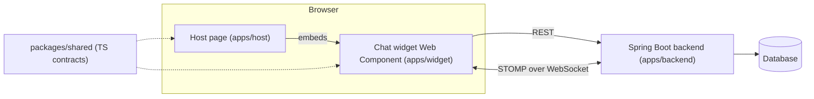

# Chatforge

A real-time messaging platform featuring an embeddable chat widget, built with Spring Boot, STOMP, Vue 3, and TypeScript. Designed as a modular monorepo with independent backend, widget, and host applications.

> **Status:** early setup. The repository structure, licensing, and documentation are in place. The applications are **not implemented yet**; sections marked _planned_ describe the intended design.

## Project Overview

Chatforge lets a website owner add live chat by embedding a single script. Visitors talk to agents through a Vue 3 Web Component that connects to a Spring Boot backend over REST and STOMP (WebSocket). The monorepo keeps the backend, the widget, and a demo host application independent, with shared TypeScript contracts between the front-end packages.

## Key Features

_Planned:_

- Embeddable chat widget delivered as a framework-agnostic Web Component
- Real-time messaging over STOMP/WebSocket
- JWT-based authentication and authorization
- Persistent conversation history
- Demo host application showing widget integration

## Architecture Overview

_Planned architecture:_



## Technology Stack

| Area | Technology |
| --- | --- |
| Backend | Spring Boot, STOMP over WebSocket |
| Widget | Vue 3, TypeScript, Web Components |
| Host app | Vue 3, TypeScript |
| Shared | TypeScript |
| Tooling | pnpm workspaces, Docker Compose |

Specific versions, build tool (Gradle or Maven), and database engine are still to be decided.

## Monorepo Structure

```text
chatforge/
├── apps/
│   ├── backend/   # Spring Boot REST API, authentication, persistence, STOMP messaging
│   ├── widget/    # Vue 3 embeddable Web Component
│   └── host/      # Vue 3 demo application integrating the widget
├── packages/
│   └── shared/    # Shared TypeScript contracts and utilities
├── docs/
├── docker-compose.yml
├── pnpm-workspace.yaml
├── package.json
├── README.md
├── LICENSE
└── .gitignore
```

## Getting Started

```bash
git clone git@github.com:dzulfanf/chatforge.git
cd chatforge
pnpm install
```

At this stage `pnpm install` only sets up the empty workspace. There is nothing to run yet.

## Prerequisites

- Node.js 20 or newer
- pnpm (version pinned in `package.json`)
- JDK 21 (_planned_, needed for the backend)
- Docker (_planned_, for local services)

## Environment Variables

Copy each `.env.example` to `.env` and replace the placeholders. `.env` files are git-ignored and must never be committed. Variable names are proposed and may change during implementation.

| File | Variables |
| --- | --- |
| `.env.example` | `POSTGRES_DB`, `POSTGRES_USER`, `POSTGRES_PASSWORD` |
| `apps/backend/.env.example` | `SERVER_PORT`, `DB_URL`, `DB_USERNAME`, `DB_PASSWORD`, `JWT_SECRET`, `JWT_EXPIRATION`, `CORS_ALLOWED_ORIGINS` |
| `apps/widget/.env.example` | `VITE_API_BASE_URL`, `VITE_WS_URL` |
| `apps/host/.env.example` | `VITE_API_BASE_URL`, `VITE_WS_URL` |

`VITE_*` variables end up in the client bundle, so they must never hold secrets.

## Development Commands

Not available yet. Commands for running the backend, widget, and host will be documented here as each is implemented.

## Testing

No tests exist yet. Test commands and coverage expectations will be documented as features are implemented.

## Widget Embedding Guide

_Draft, planned API; not implemented yet._

```html
<script type="module" src="https://your-chatforge-host/widget.js"></script>
<chatforge-widget api-url="https://your-chatforge-host/api"></chatforge-widget>
```

The element name, attributes, and distribution URL may change before the first release.

## Documentation

- [Product requirements and setup guidelines](./docs/PRD.md)
- [Documentation index](./docs/README.md)

## AI-Assisted Development

This project is developed with AI-assisted engineering workflows, using Claude Code as a development assistant.

AI tools are used to support:
- Architecture exploration and technical planning.
- Code implementation and refactoring.
- Test generation and debugging.
- Technical documentation.

All generated code and implementation decisions are reviewed, validated, and maintained by the project owner.

The project owner is responsible for the architecture, code quality, security, and overall project direction.

## License

Released under the [MIT License](./LICENSE).
